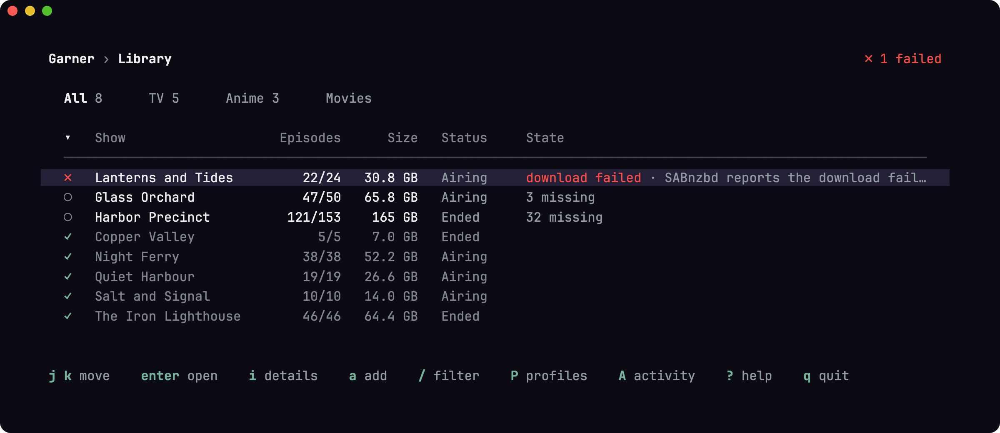

# Garner

Garner manages TV shows and anime for a self-hosted media library. It finds releases through [Prowlarr](https://prowlarr.com), downloads them with [SABnzbd](https://sabnzbd.org), checks every file with FFprobe, moves it into the library and confirms the import through [Jellyfin](https://jellyfin.org). You run the server, `garnerd`, next to those services and use it from a terminal interface, `garner`, on any machine.



- **Watches your shows.** The monitor searches for new episodes, or every missing one, and downloads the best release that fits the show's rules. When the show's profile wants upgrades, it replaces a file below the first preference, such as 720p, when a better release turns up.
- **Explains every decision.** Every release in a search gets a verdict and the reasons for it: which episode it holds, which language and resolution it has and why it ranks where it does.
- **Checks files before they reach the library.** FFprobe confirms the audio language, resolution and runtime of each file. Jellyfin then has to identify the file as the intended episode.
- **Handles anime numbering.** Scene numbering and absolute episode numbers come from [TheXEM](https://thexem.info), so releases of long-running anime match the right episodes.
- **Takes over the files you already have.** When you add a show, Garner adopts its existing files instead of downloading them again.

Garner is young: versions start with `0.`, and a new version can change how things work. It handles TV shows and anime from Usenet only; it has no movies, no torrents and no 4K.

## What you need

- A Linux server with Podman or Docker. Release images are built for x86 (`linux/amd64`).
- Prowlarr with at least one Newznab indexer, SABnzbd with a Usenet provider, and Jellyfin with the TheTVDB plugin.
- One filesystem or share that holds both SABnzbd's completed downloads and the library. Garner moves files with a rename, which works only within one filesystem.

Garner gets show and episode data from TheTVDB with its own key, which the release images bring along. To use a key of your own, set `TVDB_API_KEY`.

## Get started

1. Install the server: [docs/install.md](docs/install.md) walks through the configuration, the container and the first connection. To set up Garner, Prowlarr and SABnzbd together with Docker Compose, use the [Compose example](examples/compose) instead.
2. Install the terminal interface on the machine you use it from. Download the file for that machine from the [latest release](https://github.com/trucke/garner/releases/latest): `garner-<version>-darwin-arm64` for a Mac with Apple silicon, `darwin-amd64` for an Intel Mac, `linux-amd64` for Linux on x86 or `linux-arm64` for Linux on ARM. Then move it into your path and make it executable. On a Mac with Apple silicon:

   ```bash
   mkdir -p ~/.local/bin
   mv ~/Downloads/garner-*-darwin-arm64 ~/.local/bin/garner
   chmod +x ~/.local/bin/garner
   ```

   The first time you run it, macOS asks whether to open a program downloaded from the internet; choose **Open**. The file is signed with Garner's developer certificate and checked by Apple. On other machines, use their file instead. If your shell does not find `garner` afterwards, add `~/.local/bin` to your `PATH`.

3. Run `garnerd token create <device>` on the server, run `garner` on your machine and paste the connection code. The terminal interface remembers the connection in `~/.config/garner/connection`.
4. Press `a` to add a show. Press `?` on any screen for its keys.

## Choose which releases Garner accepts

Every show has a profile that says which releases Garner accepts for it: the audio languages and resolutions, best first, called its preferences, and a few settings. A new installation starts with the profile Original language, which wants each show in its original audio, 1080p before 720p. Garner ships four more to start from: German; German, English fallback; English; and Original, English dub.

To manage the profiles, press `P` in the terminal interface. There you create a profile, start one from a shipped one, change one, import one from a link or pasted text, export one to a file, and choose the profile that new TV and new anime shows get. To give a show another profile, press `p` on its details page. [Profiles](docs/profiles.md) describes the format, so you can share profiles and use the ones others wrote.

Every show also has a type, TV or anime. Anime reads a bare number such as 101 as an absolute episode number first, and the files of anime shows go to `library.anime`. Garner sets the type from TheTVDB's genres; `p` on the details page changes it too.

A release that names no language counts as the show's original language. The file check after download confirms the language.

Some rules apply under every profile: Garner never downloads a remux or a 2160p release on its own, ranks the releases that meet the same preference by size, completeness, source and age, and checks each video before importing it. [How Garner chooses releases](docs/releases.md) lists them all.

## Files in the library

Garner manages one file per episode: the files it imports and the files it takes over. It leaves every other file in the library alone.

### Taking over files

When you add a show, Garner looks for the show's video files before the monitor starts on it. It looks in two places:

- Garner's folder for the show, such as `Harbor.Precinct.Night.Shift.2013.[tvdbid-42]`
- every folder that Jellyfin holds the show in, found by the show's TVDB ID, whatever the folder is called

Garner takes over a file when its name clearly names episodes that have no file yet. FFprobe reads the file's audio languages and resolution, which say which preference of the profile the file meets, as for a download. A file that meets none, such as English audio under the German profile, ranks below every preference, so an upgrade replaces it. Of two files for one episode, Garner takes the one that meets the better preference, then the larger one. The terminal interface lists the files that Garner left alone, with the reason. To look again, for example after copying files into the library by hand, press `t` on the show's details page.

Garner reaches Jellyfin's folders only through `jellyfin.paths` in `garner.toml`. Map every folder that Jellyfin's libraries use, including the folders of a library from before Garner, and mount each one into Garner's container at the mapped path. When no mapping covers a folder, the terminal interface names the folder, and Garner looks only in its own folder.

### What taking over means for your files

A taken-over file belongs to Garner from then on, like a file it imported:

- An upgrade replaces the file and deletes it, with its subtitle files.
- Deleting the show with **Delete files** deletes the file. **Keep files** leaves it in place, and adding the show again takes it over again.
- The file keeps its name and folder. After a take-over, the terminal interface asks whether to rename and move the files outside Garner's folder into that folder, named the way Garner names files. **Keep as they are** is preselected.

Renaming moves the subtitle files along, never overwrites a file and tells Jellyfin about the moves. It removes the folders that the moves left empty. A folder that still holds other files, such as Jellyfin's `tvshow.nfo`, stays, and Jellyfin may still list it as a show. Garner moves files without copying them, so a file on another filesystem than Garner's folder stays where it is.

## Responsible use

Garner automates searching and downloading. It provides no content and no indexers. Download only what you have the right to download where you live.

## Contributing

Bug reports and pull requests are welcome; [CONTRIBUTING.md](CONTRIBUTING.md) explains the development setup. To report a security problem, follow [SECURITY.md](SECURITY.md).

## Data sources

Metadata provided by [TheTVDB](https://thetvdb.com). Please consider adding missing information or subscribing.

Scene numbering and alternative titles come from [TheXEM](https://thexem.info). Reviewed corrections to that data live in `internal/catalog/corrections.toml`.

## License

Garner is released under the [MIT license](LICENSE). The Go modules the released binaries are built with are listed with their licenses in [THIRD-PARTY-NOTICES.txt](THIRD-PARTY-NOTICES.txt), which ships with them. The container image also contains an FFprobe built from [FFmpeg](https://ffmpeg.org) under the LGPL 2.1 or later; its license text is in the image at `/usr/share/licenses/ffprobe`.
